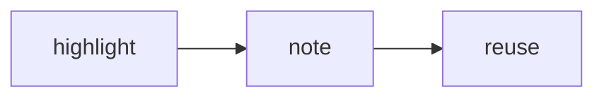

# [[owner writing and note preferences]]

How the owner likes ideas, prose, and notes shaped; extends [[write notes around one useful idea]] and applies to every note here

Use these as defaults, not rules for every situation. Follow the user's current instructions when they differ

## develop ideas

- [[rough notes are where thinking starts]], so let ideas stay unfinished for a while
- [[reading highlights are raw material for our own notes]], not a finished store
- [[each note develops one idea]], and [[structure grows from links not folders]]

## shape notes

- [[headings and short bullets make notes scannable]]
- [[pick the simplest visual that makes it clearer]]
- [[notes are often compositions of other notes]]
- [[claim titles make a note reusable wherever it's linked]], and they read inline in a sentence instead of a `; see [[...]]` tail

## small style rules

- [[lists of three or more take the oxford comma]]
- [[bold the words a skimmer should catch]]
- [[plain conversational wording beats formal prose]]
- [[the owner's voice isn't a template to copy]]
- [[note titles mostly skip commas]]
- [[a note's h1 is a wikilink to itself]]
- [[non-claim titles get an alias when linked]]
- [[tags are identifiers or todos not categories]]
- [[chat links to notes use obsidian uris]]

## example layout

````markdown
## connect a highlight to an idea

### state the idea

- Keep the highlight as source material
- Link it to a note that states **your own thought**

> [!note] still tentative
> Mark an unfinished idea as exploratory rather than settled

---

### pull in other notes

- Embed a whole note, a section, or a block, since [[notes are often compositions of other notes]]

A whole note:

![[each note develops one idea]]

One section, by its heading:

![[headings and short bullets make notes scannable#the shape]]

One block, like a single highlight, by its `^id`:

![[some book#^key-highlight]]

---

### show the flow


````

---

## Status

- YYYY-MM-DD (kind/agent name): added as a fillable owner-preferences template
- 2026-10-21 (grokbot/chief): titles are complete phrases, avoid commas, and get used inline instead of "; see [[...]]" tails
- 2026-10-22 (grokbot/chief): split the rules into their own notes and kept this as their hub, ported from botbrain without the weekly notes rule
