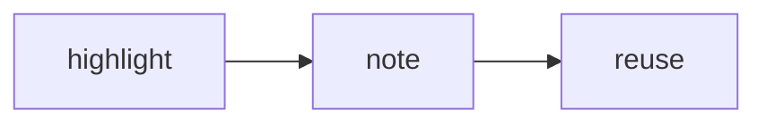

# {owner}'s writing and note preferences

How {owner} likes ideas, prose, and notes shaped; extends [[write notes around one useful idea]] and applies to every note here


Use these as defaults, not rules for every situation. Follow the user's current instructions when they differ.

## Develop ideas

- Treat reading highlights and saved links as raw material to revisit, connect, rewrite, and use
- Let thought start with rough notes, questions, links, and side paths, then shape a through-line when useful
- Build ideas from focused parts that each retain enough context to stand on their own
- Preserve questions, asides, and roughness when they show an idea is still developing
- Don't polish exploratory thoughts into false certainty
- Favor better thinking over collecting more material or maintaining an elaborate note system

## Shape writing for scanning

- Use descriptive `##` and `###` headings to label sections and ideas
- Put the explanation in short bullets under a heading instead of using bold inline labels as mini-headings
- Keep each bullet to one sentence and leave off its terminal period
- Keep lists to a handful of bullets, splitting long lists under another heading
- Use **bold** sparingly to emphasize a few useful words
- Prefer plain, conversational wording and concrete examples
- Lowercase, fragments, asides, and playful names may fit {owner}'s notes, but don't imitate them mechanically

## Mix text and visuals

- Use a short lead sentence when it helps orient the reader
- Combine prose, bullets, block quotes, backlinks, and embeds when each adds something
- Don't force every idea into an outline
- Use horizontal rules for meaningful breaks and callouts for useful asides or emphasis
- Choose Mermaid, ASCII diagrams, ASCII tables, or interactive formats when they make a relationship, comparison, or workflow easier to see
- Pick the simplest visual that clarifies the point because there is no fixed house style

## Work with notes

- Take inspiration from Andy Matuschak's evergreen-note ideas without imposing a strict Zettelkasten
- Keep one main idea or claim in a note while preserving enough context for it to make sense
- Use claim-like titles when they sharpen the idea
- Treat links as meaningful associations and folders as shallow orientation, not as a complete taxonomy
- Use tags mainly as identifiers or todos, following existing conventions
- Keep the system low-friction; scratch notes and imperfect links are acceptable
- Improve links and discoverability when useful without making upkeep the goal
- Treat highlight exports as read-only source material, then reference or embed highlights in {owner}'s own notes
- Keep weekly notes reflective rather than turning them into task lists
- Leave room in reflection for seeds of ideas, new things, accomplishments, and good or bad feelings
- Use templates as light, purpose-specific prompts rather than exhaustive forms
- Leave open space around prompts and keep priority lists short

## example layout

````markdown
## connect a highlight to an idea

### state the idea

- Keep the highlight as source material
- Link it to a note that states **your own thought**

> [!note] still tentative
> Mark an unfinished idea as exploratory rather than settled

---

### show the flow


````

---

## Status

- YYYY-MM-DD (kind/agent name): added as a fillable owner-preferences template
